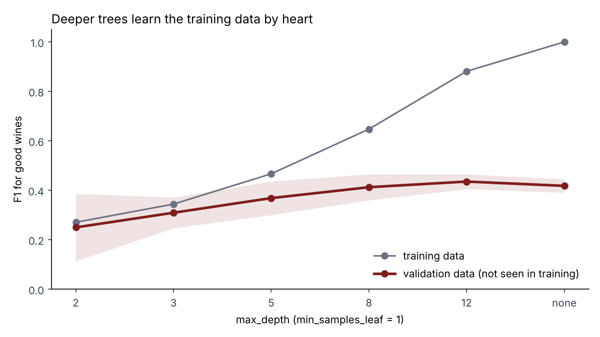
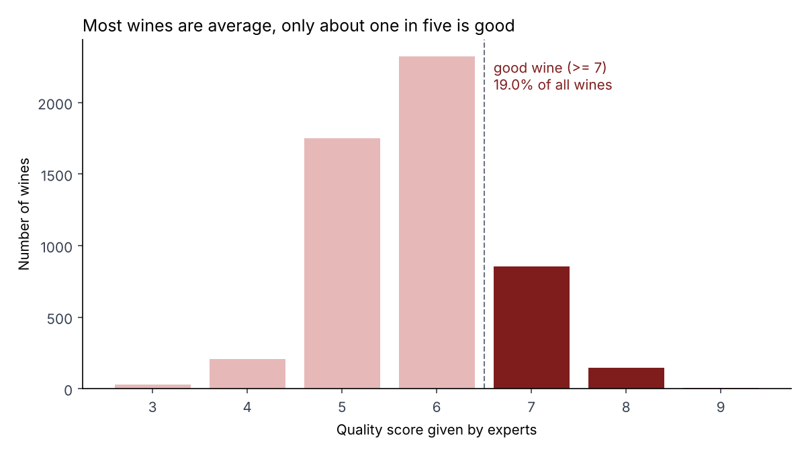
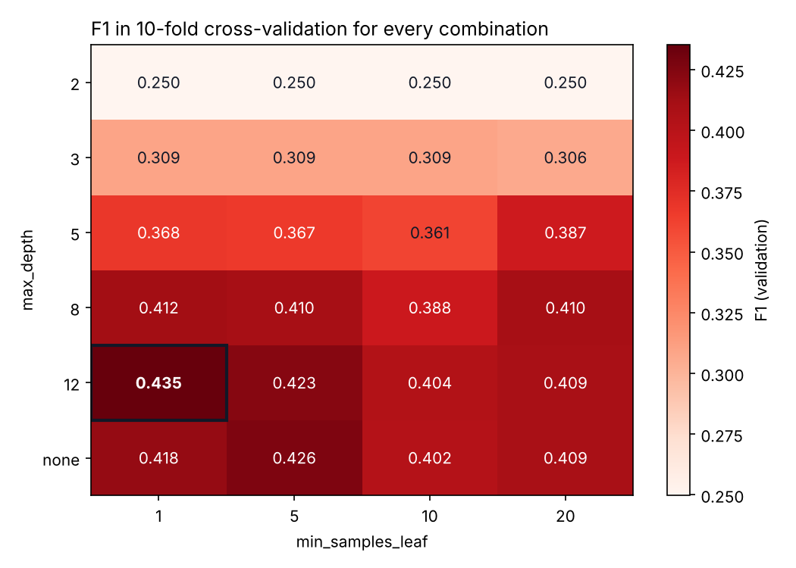
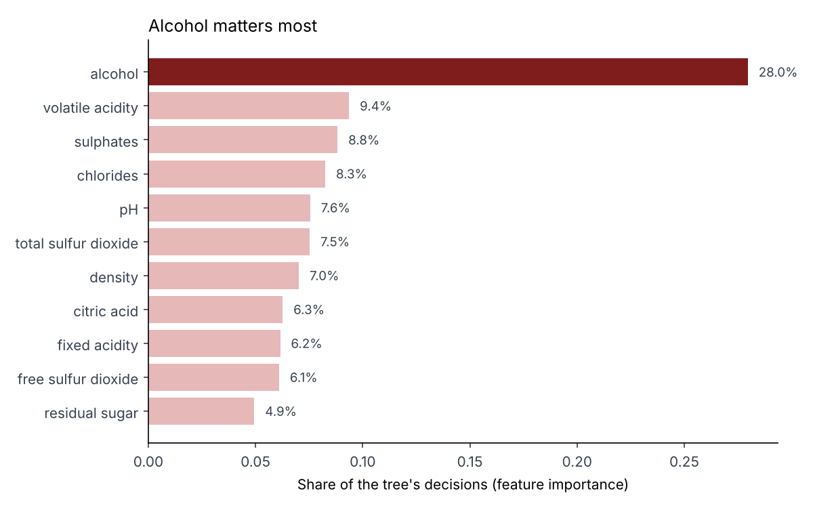
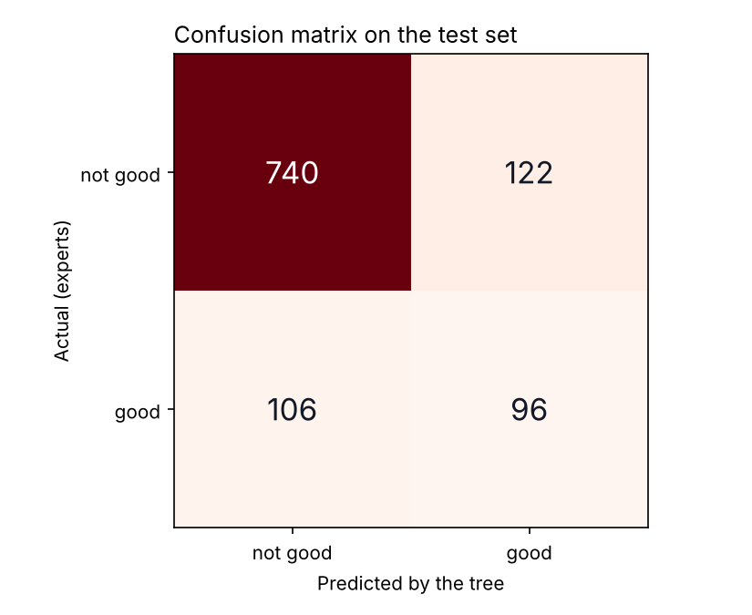
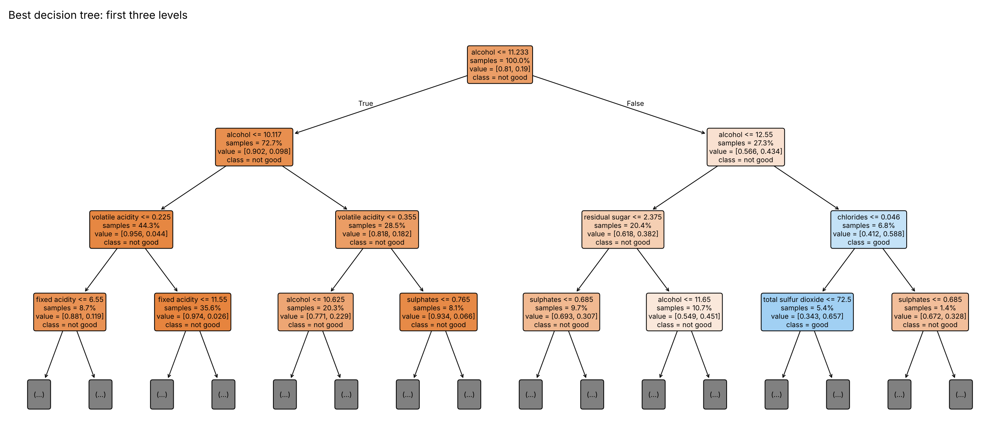

<div align="center">

# Wine Quality Decision Tree

**Can a decision tree tell a good wine from an average one using only its lab results? A data mining experiment on the UCI Wine Quality dataset, with a grid search over tree settings and 10-fold cross-validation.**

<p>
  
  
  
  
  
  
</p>

<p>
  <a href="#about">About</a> |
  <a href="#results">Results</a> |
  <a href="#charts">Charts</a> |
  <a href="#quick-start">Quick start</a> |
  <a href="#method">Method</a> |
  <a href="#tech">Tech</a>
</p>



</div>

## About

This is my part of the group project for *Data Warehousing and Data Mining* (Hurtownie i eksploracja danych) at Wroclaw University of Science and Technology, 2026/27. The project has two independent parts: a data warehouse and a data mining experiment. This repository is the data mining part.

The data is the [Wine Quality](https://archive.ics.uci.edu/dataset/186/wine+quality) dataset from the UCI Machine Learning Repository: Portuguese *vinho verde* wines, each described by 11 lab measurements (acidity, sugar, sulphates, alcohol and so on) and a quality score from 0 to 10 given by experts.

The task is **supervised binary classification**: the tree has to say whether a wine is **good** (score 7 or higher) or **not good**. The experiment looks for the tree settings that do this best and checks how well the best tree works on wines it has never seen.

### Research questions

1. Which tree depth and minimum leaf size give the best results for finding good wines?
2. At what depth does the tree start to overfit, that is, learn the training wines by heart?
3. Which lab measurements matter most for the quality score?

## Results

| | Value |
| --- | --- |
| Wines after removing duplicates | 5,320 (1,359 red, 3,961 white) |
| Good wines | 19.0% |
| Combinations tested | 24 (6 depths × 4 leaf sizes), each with 10-fold cross-validation |
| Best settings | `max_depth = 12`, `min_samples_leaf = 1` |
| F1 in cross-validation | 0.435 |
| **F1 on the test set** | **0.457** |
| Accuracy on the test set | 78.6% |
| Recall / precision on the test set | 47.5% / 44.0% |

### What the numbers say

- **Accuracy is misleading here.** A "model" that always answers *not good* would be right 81.0% of the time, more than the tree's 78.6%, and it would never find a single good wine. That is why the tree is judged on **F1** for the good class. On that measure the always-*not-good* answer scores 0 and the tree scores 0.457.
- **The tree finds about half of the good wines.** On the test set it found 96 of the 202 good wines and raised 122 false alarms among 862 average ones.
- **Overfitting is clear.** With no depth limit the tree is perfect on training data (F1 = 1.00) but scores only 0.418 on validation data. The best depth, 12, still has a large gap (0.88 vs 0.435).
- **The top settings are close.** The best five combinations are within 0.025 F1 of each other, which is less than the spread between folds (about 0.03 to 0.05). Depth matters a lot; leaf size matters little.
- **Alcohol matters most.** It accounts for 28% of the tree's decisions, three times more than the next measurement (volatile acidity, 9.4%). The very first question the tree asks is *alcohol ≤ 11.2%?*

All numbers are in [`results/summary.json`](results/summary.json), and the full table of 24 combinations is in [`results/grid_search_results.csv`](results/grid_search_results.csv).

## Charts

| | |
| --- | --- |
|  |  |
| **Quality scores**: only about one wine in five is good | **Grid search**: F1 for every combination, best one framed |
|  |  |
| **Feature importance** of the best tree | **Confusion matrix** on the test set |



**The best tree, first three levels.** Orange boxes lean towards *not good*, blue boxes towards *good*. The full rules (four levels) are in [`results/best_tree_rules.txt`](results/best_tree_rules.txt).

## Quick start

You need Python 3.10 or newer.

```bash
git clone https://github.com/tworekrobert/wine-quality-decision-tree.git
cd wine-quality-decision-tree
pip install -r requirements.txt
python experiment.py
```

The run takes about 10 seconds. It prints a short summary and writes the tables to `results/` and the charts to `figures/`. The random seed is fixed, so every run gives the same numbers.

## Method

| Step | What happens |
| --- | --- |
| 1. Data | Red and white wines are joined into one table. The 11 lab measurements are the input. |
| 2. Cleaning | 1,179 rows (18%) are exact copies of another row and are removed (see *Design decisions*). |
| 3. Target | Quality ≥ 7 becomes *good* (1), everything else *not good* (0). |
| 4. Test set | 20% of wines are put aside and not touched until the end. The split keeps the same share of good wines in both parts. |
| 5. Grid search | Every combination of `max_depth` (2, 3, 5, 8, 12, no limit) and `min_samples_leaf` (1, 5, 10, 20) is tried. |
| 6. Cross-validation | Each combination is scored with 10-fold stratified cross-validation on the remaining 80%: train on 9 parts, test on 1, repeat 10 times, average. |
| 7. Choice | The combination with the best average F1 wins and is trained again on the whole 80%. |
| 8. Final check | The winner is scored once on the 20% test set: accuracy, precision, recall, F1 and the confusion matrix. |

## Project structure

```text
wine-quality-decision-tree/
|-- data/
|   |-- winequality-red.csv      # original UCI files, ';' separated
|   `-- winequality-white.csv
|-- figures/                     # charts made by experiment.py
|-- results/
|   |-- grid_search_results.csv  # all 24 combinations with their scores
|   |-- summary.json             # best settings and test set results
|   `-- best_tree_rules.txt      # the best tree as readable if/else rules
|-- experiment.py                # the whole experiment, step by step
`-- requirements.txt
```

## Tech

| Part | Choice |
| --- | --- |
| Language | Python 3.10+ |
| Model | `DecisionTreeClassifier` from scikit-learn |
| Search | `GridSearchCV` with `StratifiedKFold` (10 folds) |
| Data | pandas |
| Charts | matplotlib |

## Design decisions

| Decision | Why |
| --- | --- |
| Duplicates removed | 18% of rows are exact copies. A copy in both the training and the test part lets the tree remember the answer instead of learning a rule. With duplicates kept, the unlimited tree "won" with test F1 0.61, which was too good to be true. |
| F1 instead of accuracy | Only 19% of wines are good, so accuracy rewards a model that ignores them. F1 only goes up when the tree actually finds good wines. |
| Separate test set | The grid search picks the best of 24 scores, which flatters the winner a little. A test set that took no part in the choice gives an honest final number. |
| Stratified folds | Every fold keeps about 19% good wines, so no fold is accidentally easy or hard. |
| One algorithm | The project brief asks for one data mining algorithm. The conclusions come from comparing its settings. |
| Red and white together | More data for the tree. Wine type is not used as an input, so the tree has to rely on the lab measurements. |

## Limitations

- The tree finds only about half of the good wines. Class weights (`class_weight="balanced"`) or a random forest would likely do better, but were outside the scope of this part of the project.
- The quality score is the median of at least three expert ratings, so the target itself is subjective and noisy.
- No statistical test is used to compare the top settings. The spread between folds is reported instead.

## Data

P. Cortez, A. Cerdeira, F. Almeida, T. Matos and J. Reis. *Modeling wine preferences by data mining from physicochemical properties.* Decision Support Systems, 47(4):547–553, 2009. The dataset is published in the [UCI Machine Learning Repository](https://archive.ics.uci.edu/dataset/186/wine+quality) under the CC BY 4.0 licence.
